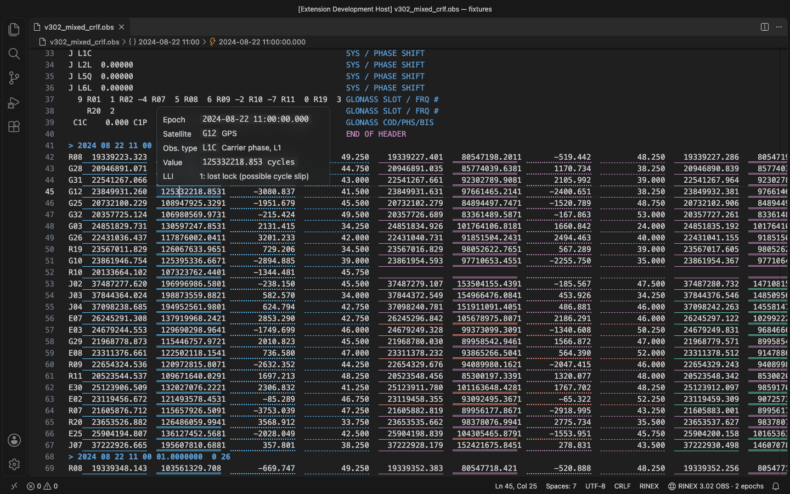
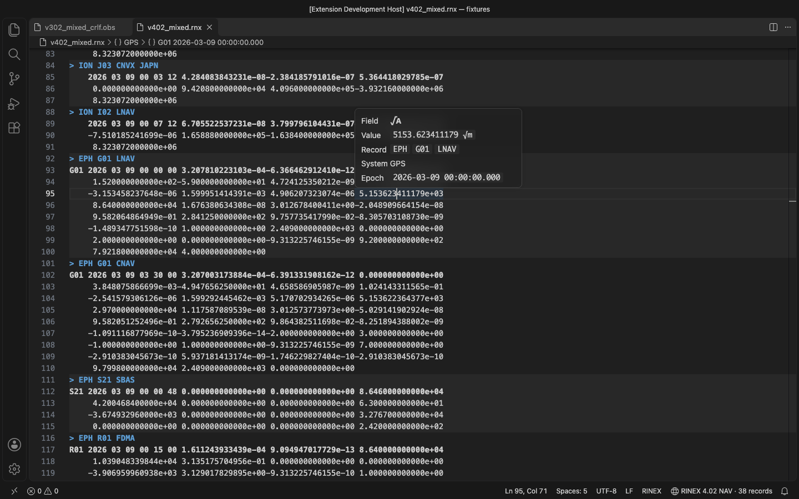
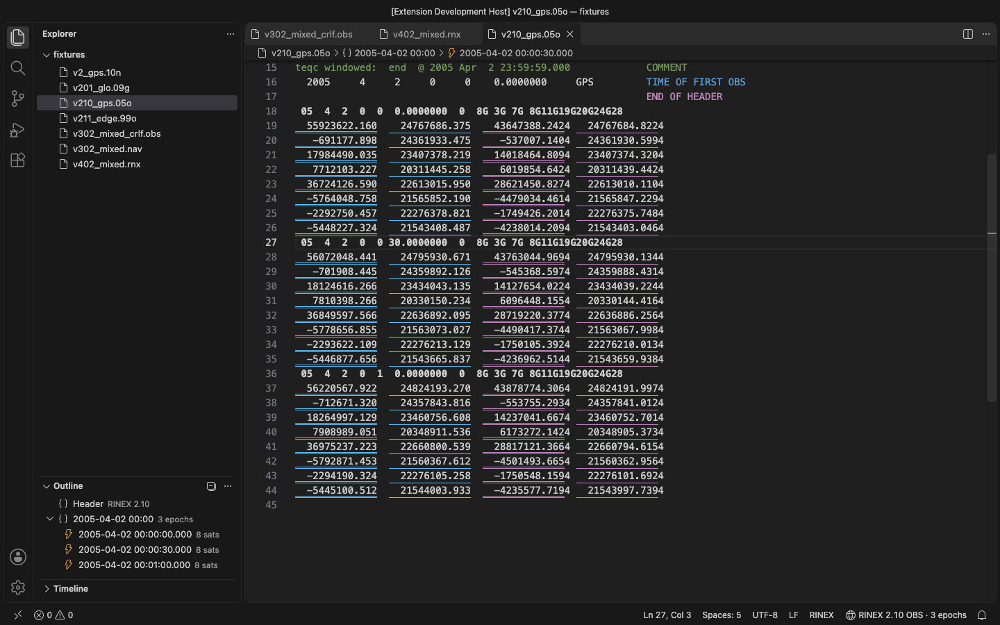

# rinex-viewer README

"rinex-viewer" is a viewer designed to enhance the readability of Receiver INdependent EXchange (RINEX) files.

## Features

### Observation files

* Observation values are underlined by frequency band (color) and observable type
  (pseudorange: solid, carrier phase: double, Doppler: dotted, signal strength: dashed).
* Epoch lines are shown in bold, special event records (epoch flag 2-5) in italics.
* Hover over a value to see the epoch, satellite, observation type, value, LLI and SSI.
* Hover over header labels and observation type codes for a short description.

<picture>
  <source media="(prefers-color-scheme: light)" srcset="images/observation-light.png">
  
</picture>

### Navigation files

* Hover over any value to see the parameter name and unit (e.g. `√A [√m]`, `Toe`, `IODC`),
  for GPS, GLONASS, Galileo, BeiDou, QZSS, NavIC/IRNSS and SBAS.
* RINEX 4 `EPH` (LNAV, CNAV, CNV2, INAV, FNAV, D1/D2, CNV1-3, FDMA, SBAS), `STO`, `EOP` and `ION` records are supported.
* The first line of each record is shown in bold and every other record is shaded.

<picture>
  <source media="(prefers-color-scheme: light)" srcset="images/navigation-light.png">
  
</picture>

### Common

* **Outline / breadcrumbs**: header and epochs grouped by hour (observation), records grouped by system (navigation).
* **Folding** of the header, each epoch and each navigation record.
* **Status bar** summary of the active file; click it (or run `RINEX: Show File Summary`) to open the full summary
  (time span, interval, satellites, observation types, record counts).
* **`RINEX: Go to Epoch...`** jumps to an epoch or navigation record.
* Only the visible part of the editor is decorated and hovers are computed on demand, so large files stay responsive.

<picture>
  <source media="(prefers-color-scheme: light)" srcset="images/outline-light.png">
  
</picture>

## Supported Formats

| Type | Versions | File names |
| --- | --- | --- |
| Observation | 2.10, 2.11, 3.0x, 4.0x | `*.YYo`, `*.obs`, `*.rxo`, `*.rnx` |
| Navigation | 2.xx, 3.0x, 4.0x | `*.YYn`, `*.YYg`, `*.YYh`, `*.YYl`, `*.YYp`, `*.YYq`, `*.nav`, `*.rnx` |

Files with other names are recognized when their first line contains `RINEX VERSION / TYPE`.
Compressed files (Hatanaka `.crx`/`.YYd`, `.gz`) must be decompressed first.

Note: VS Code does not synchronize files larger than 50 MB with extensions, so decorations, hovers and the outline
are not available for them.

## Settings

| Setting | Default | Description |
| --- | --- | --- |
| `rinexViewer.decorations.enabled` | `true` | Underline values and highlight epoch / record lines |
| `rinexViewer.statusBar.enabled` | `true` | Show the file summary in the status bar |

Colors can be customized with `workbench.colorCustomizations`
(`rinexViewer.band1` ... `rinexViewer.band9`, `rinexViewer.alternateRecordBackground`, `rinexViewer.eventForeground`).

## Development

```sh
npm install
npm test                  # parser unit tests (node:test)
npm run test:integration  # extension tests in VS Code
```

## License

This project is licensed under the MIT License. See the [LICENSE](LICENSE) file for more information.
